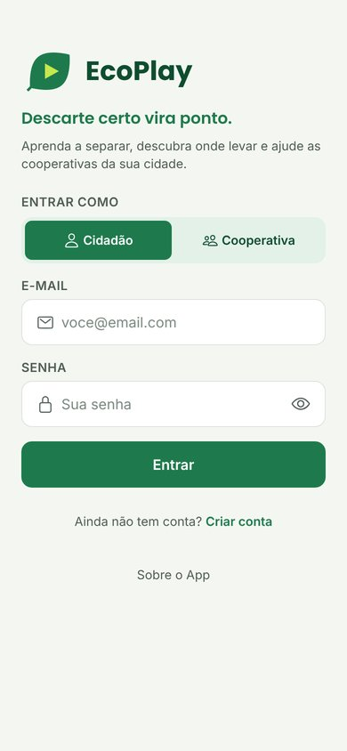
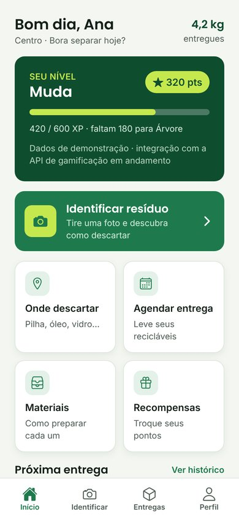
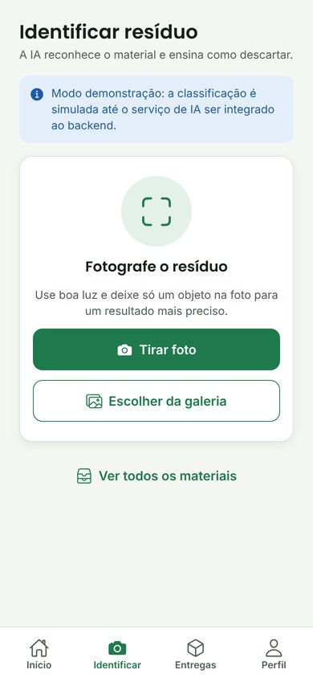
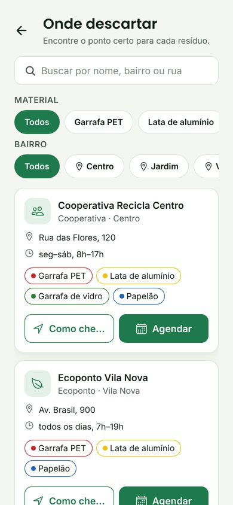
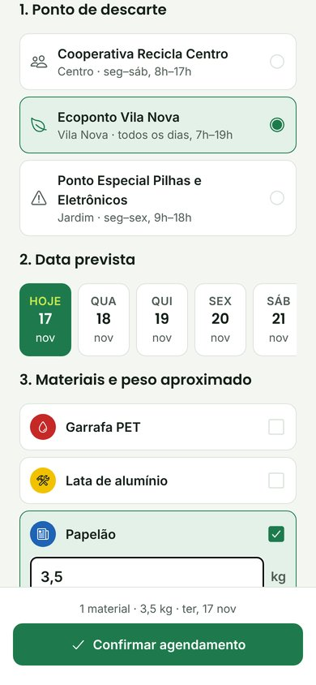
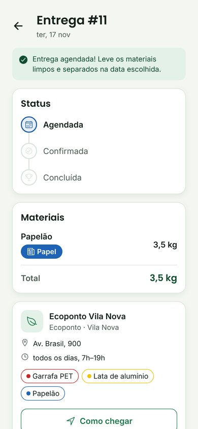
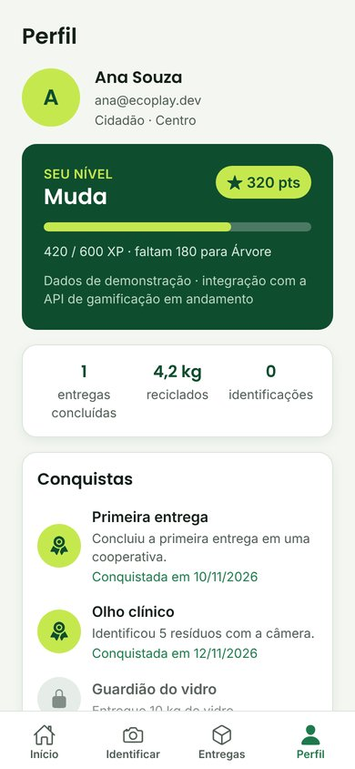
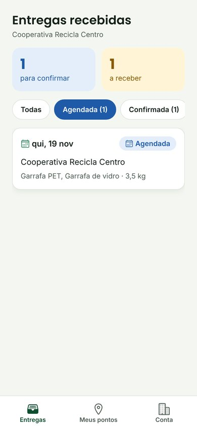
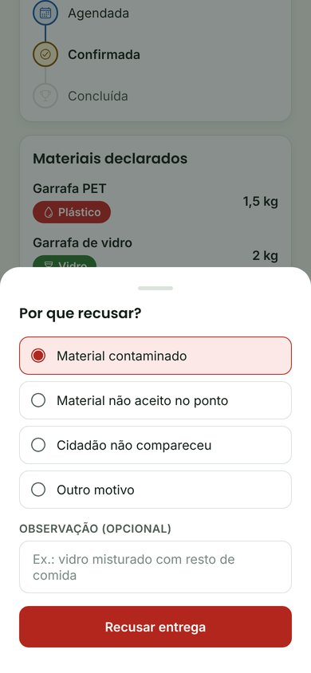
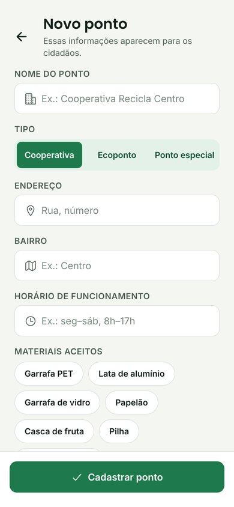

<div align="center">


# EcoPlay — App Mobile

**Descarte certo vira ponto — e renda para quem recicla.**

Global Solution 2026/2 · CitizenTech · FIAP 2TDS · Mobile Application Development


</div>

## 🎥 Vídeo de demonstração

**▶️ [Assistir no YouTube](https://youtu.be/COLOCAR-LINK-AQUI)** (até 5 minutos)

## 📖 Sobre o projeto

O EcoPlay é um aplicativo de reciclagem que ensina o cidadão a separar o lixo, identifica materiais por foto com IA, mostra onde levar cada resíduo e conecta quem separa às cooperativas de catadores. Pontos, níveis e conquistas vêm de **entregas confirmadas pela cooperativa**, e não de cliques.

O app tem duas áreas com interfaces diferentes:

- **Cidadão:** identifica resíduos, consulta materiais e pontos de descarte, agenda entregas e acompanha a gamificação.
- **Cooperativa:** recebe as entregas, confirma, recusa (com motivo) ou conclui, e administra seus pontos de descarte.

## 👥 Equipe

| Integrante                    | RM     | Responsável por                    |
| ----------------------------- | ------ | ---------------------------------- |
| Maria Gabriela Landim Severo  | 565146 | **Mobile Application Development** |
| Camily Vitoria Pereira Maciel | 566520 | Java Advanced                      |
| Lucas Nunes Soares            | 566503 | IA (Python) e .NET                 |
| Samara Porto Souza            | 559072 | Banco de dados                     |
| Eduarda Weiss Ventura         | 564434 | DevOps e QA                        |

## 📱 Telas

| Login                                                | Início                                                | Identificar                                                | Pontos de descarte                                    | Agendar entrega                                        |
| ---------------------------------------------------- | ----------------------------------------------------- | ---------------------------------------------------------- | ----------------------------------------------------- | ------------------------------------------------------ |
|  |  |  |  |  |

| Detalhe da entrega                                             | Perfil                                                | Cooperativa: recebidas                                               | Cooperativa: recusar                                               | Cooperativa: novo ponto                                          |
| -------------------------------------------------------------- | ----------------------------------------------------- | -------------------------------------------------------------------- | ------------------------------------------------------------------ | ---------------------------------------------------------------- |
|  |  |  |  |  |

### Lista completa (16 telas, sem contar "Sobre o App")

| #   | Tela                                                         | Perfil      | Integração                                              |
| --- | ------------------------------------------------------------ | ----------- | ------------------------------------------------------- |
| 1   | Login (com seleção Cidadão / Cooperativa)                    | público     | `POST /api/auth/login`                                  |
| 2   | Cadastro                                                     | público     | `POST /api/usuarios/cadastro`                           |
| 3   | Início (saudação, nível, atalhos, próxima entrega)           | cidadão     | `GET /api/entregas/cidadao/{id}` + gamificação          |
| 4   | Identificar resíduo → resultado → correção                   | cidadão     | IA + `POST /api/identificacoes` + `PATCH .../confirmar` |
| 5   | Materiais recicláveis                                        | cidadão     | `GET /api/materiais`                                    |
| 6   | Pontos de descarte (filtros por material e bairro)           | cidadão     | `GET /api/pontos-descarte`                              |
| 7   | Minhas entregas (próximas / histórico)                       | cidadão     | `GET /api/entregas/cidadao/{id}`                        |
| 8   | Agendar entrega                                              | cidadão     | `POST /api/entregas`                                    |
| 9   | Detalhe da entrega (reagendar / cancelar)                    | cidadão     | `GET`, `PUT .../reagendar`, `DELETE`                    |
| 10  | Perfil (nível, XP, conquistas, estatísticas)                 | cidadão     | gamificação + `GET /api/identificacoes/usuario/{id}`    |
| 11  | Recompensas (lojinha)                                        | cidadão     | gamificação (.NET)                                      |
| 12  | Entregas recebidas (filtro por status)                       | cooperativa | `GET /api/entregas/cooperativa/{id}`                    |
| 13  | Detalhe da entrega recebida (confirmar / recusar / concluir) | cooperativa | `PATCH .../confirmar`, `.../recusar`, `.../concluir`    |
| 14  | Meus pontos                                                  | cooperativa | `GET`, `DELETE /api/pontos-descarte`                    |
| 15  | Cadastrar / editar ponto                                     | cooperativa | `POST`, `PUT /api/pontos-descarte`                      |
| 16  | Conta da cooperativa (impacto, logout)                       | cooperativa | `GET /api/entregas/cooperativa/{id}`                    |
| —   | Sobre o App (hash do commit)                                 | todos       | `app.config.js`                                         |

## ✅ Requisitos da disciplina

| Requisito                          | Como foi atendido                                                                                                                                                                                                                                                                                                  |
| ---------------------------------- | ------------------------------------------------------------------------------------------------------------------------------------------------------------------------------------------------------------------------------------------------------------------------------------------------------------------ |
| **1. Telas e navegação**           | 16 telas com Expo Router: pilha raiz, abas do cidadão (Início · Identificar · Entregas · Perfil) e abas da cooperativa (Entregas · Meus pontos · Conta).                                                                                                                                                           |
| **2. CRUD com a API Java (Axios)** | Entregas: criar, listar, detalhar, reagendar e excluir. Pontos de descarte (cooperativa): criar, listar, editar e excluir. Todos os dados vêm da API; nada é salvo só no aparelho. Loaders, mensagens de erro e estados vazios em todas as telas.                                                                  |
| **3. Autenticação**                | Cadastro e login reais com JWT da API Java. Token guardado no `expo-secure-store` e enviado por interceptor do Axios. Rotas protegidas por sessão e por papel com `Stack.Protected`. Logout limpa o token. Sessão expirada (fim do JWT ou resposta 401) faz logout automático com aviso. Validação de formulários. |
| **4. Identidade visual**           | Paleta "Folha" (contraste WCAG AA), fontes Poppins e Inter em `assets/fonts`, logo e ícones próprios em `assets/images`, cores oficiais da coleta seletiva (CONAMA 275/2001), áreas de toque ≥ 48 dp e textos ≥ 14 sp.                                                                                             |
| **5. Arquitetura**                 | Rotas em `src/app`, componentes em `src/components`, chamadas HTTP em `src/services`, estado global em `src/contexts`, lógica reutilizável em `src/hooks`, tema em `src/theme`. ESLint + Prettier configurados.                                                                                                    |
| **6. Vídeo**                       | Link no topo deste README e no arquivo `.txt` da entrega.                                                                                                                                                                                                                                                          |
| **7. Publicação**                  | APK gerado pelo EAS e distribuído pelo Firebase App Distribution, com o professor como tester. A tela "Sobre o App" mostra o hash do commit usado no build.                                                                                                                                                        |

## 🛠️ Tecnologias e por que cada biblioteca está no projeto

Usamos só o necessário. Todas as bibliotecas Expo foram instaladas com `npx expo install`, que escolhe as versões compatíveis com o SDK 58.

| Biblioteca                                                                                     | Para quê                                                |
| ---------------------------------------------------------------------------------------------- | ------------------------------------------------------- |
| `expo` / `react-native`                                                                        | Base do app                                             |
| `expo-router`                                                                                  | Navegação por arquivos, abas e rotas protegidas         |
| `axios`                                                                                        | Cliente HTTP com interceptors (token e sessão expirada) |
| `expo-secure-store`                                                                            | Guardar o JWT de forma segura (Keystore/Keychain)       |
| `expo-image-picker`                                                                            | Câmera e galeria para identificar o resíduo             |
| `expo-font`                                                                                    | Carregar Poppins e Inter de `assets/fonts`              |
| `expo-splash-screen`                                                                           | Tela de abertura com a identidade do app                |
| `expo-constants`                                                                               | Ler o hash do commit injetado no build                  |
| `@expo/vector-icons`                                                                           | Ícones (já vêm com o Expo)                              |
| `react-native-safe-area-context` / `react-native-screens` / `expo-linking` / `expo-status-bar` | Dependências obrigatórias do Expo Router                |
| `react-native-web` / `react-dom`                                                               | Rodar no navegador durante o desenvolvimento            |
| `eslint` + `eslint-config-expo` + `prettier`                                                   | Padronização e qualidade do código                      |

Não usamos biblioteca de mapa porque a API não tem coordenadas: o botão **"Como chegar"** abre o app de mapas do aparelho com o endereço do ponto. O seletor de data também é próprio, para evitar mais uma dependência nativa.

## 🗂️ Estrutura de pastas

```
ecoplay-mobile/
├── app.config.js            # Configuração do Expo + hash do commit para o "Sobre o App"
├── eas.json                 # Perfis de build (APK para o Firebase)
├── assets/
│   ├── fonts/               # Poppins e Inter (.ttf)
│   └── images/              # Logo, ícone, splash e ícones adaptativos
├── docs/screenshots/        # Prints usados neste README
└── src/
    ├── app/                 # Rotas (Expo Router): cada arquivo é uma tela
    │   ├── _layout.tsx      # Raiz: fontes, splash e rotas protegidas por papel
    │   ├── index.tsx        # Redireciona conforme sessão e perfil
    │   ├── sobre.tsx        # Sobre o App (hash do commit)
    │   ├── (auth)/          # login, cadastro
    │   ├── (cidadao)/       # (tabs)/inicio, identificar, entregas, perfil
    │   │                    # materiais, pontos, recompensas, entrega/nova, entrega/[id]
    │   └── (cooperativa)/   # (tabs)/recebidas, meus-pontos, conta
    │                        # recebida/[id], ponto-form
    ├── components/          # Componentes reutilizáveis
    │   ├── ui/              # Botão, campo, card, tela, estados, badges, chips...
    │   ├── entregas/        # Card, linha do tempo, itens, seletor de data
    │   ├── gamificacao/     # Card de nível e conquistas
    │   ├── materiais/       # Guia de preparo e seletor de material
    │   ├── pontos/          # Card de ponto de descarte
    │   └── navigation/      # Estilo das abas
    ├── services/            # Comunicação com as APIs (uma por recurso)
    ├── contexts/            # AuthContext (sessão) e CatalogoContext (materiais e pontos)
    ├── hooks/               # useRecurso, useIdentificacao, useSair
    ├── theme/               # Cores, tipografia, espaçamentos
    ├── constants/           # Categorias, status, motivos de recusa, guias de preparo
    ├── types/               # Tipos espelhando os DTOs da API Java
    ├── config/              # Variáveis de ambiente
    └── utils/               # Formatação, validação e diálogos
```

## 🚀 Como executar

### Pré-requisitos

- Node.js 20 ou superior
- API Java do EcoPlay rodando (local ou no Azure)
- Celular com Expo Go ou emulador Android

### Passo a passo

```bash
git clone <URL-DO-REPOSITORIO>
cd ecoplay-mobile
npm install
cp .env.example .env     # ajuste a URL da API
npx expo start
```

### Variáveis de ambiente (`.env`)

| Variável                      | Descrição                                                                                                                      |
| ----------------------------- | ------------------------------------------------------------------------------------------------------------------------------ |
| `EXPO_PUBLIC_API_URL`         | URL da API Java. Emulador Android: `http://10.0.2.2:8080`. Celular físico: IP da sua máquina, ex.: `http://192.168.0.10:8080`. |
| `EXPO_PUBLIC_IA_URL`          | Serviço que expõe `POST /api/ia/identificar`. Vazio = usa a própria API Java.                                                  |
| `EXPO_PUBLIC_IA_MOCK`         | `true` usa classificação simulada até a integração Java → Python ficar pronta.                                                 |
| `EXPO_PUBLIC_GAMIFICACAO_URL` | URL da API .NET. Vazio = dados de demonstração, sinalizados na tela.                                                           |

### Contas para teste

- **Cidadão:** crie pela tela de cadastro.
- **Cooperativa:** o cadastro público aceita só cidadãos. A conta de cooperativa é criada direto no banco pela equipe (usuário com `role = 'COOPERATIVA'` e senha em BCrypt). Para testar o fluxo completo, a cooperativa precisa ter pelo menos um ponto de descarte e os materiais precisam estar cadastrados.

### Qualidade do código

```bash
npm run lint          # ESLint
npm run format:check  # Prettier
npm run typecheck     # TypeScript
```

## 🔌 Integrações

### API Java (backend principal)

O cliente fica em `src/services/api.ts`. O interceptor de requisição anexa `Authorization: Bearer <token>`, e o de resposta encerra a sessão quando a API devolve 401. As mensagens de erro do `GlobalExceptionHandler` (campo `mensagem`) aparecem direto para o usuário.

### IA de identificação (Python, via Java)

Contrato combinado com o time de IA:

```
POST /api/ia/identificar   (multipart/form-data, campo "file")
→ { "classeModelo": "garrafa_pet", "categoria": "PLASTICO", "confianca": 0.94 }
```

O app encontra o material pelo campo `classeModelo` cadastrado na API Java (ou, se não achar, pela categoria) e registra o resultado com `POST /api/identificacoes`. Com confiança abaixo de 70%, a tela pergunta "É vidro?" em vez de afirmar. O usuário pode confirmar ou corrigir. A correção é registrada com o material escolhido e confiança 1.

Classes usadas: `garrafa_pet`, `lata_aluminio`, `garrafa_vidro`, `papelao`, `casca_fruta`, `pilha`, `guardanapo_sujo`.

### Gamificação (.NET)

O app envia o mesmo JWT emitido pelo Java. Contrato esperado:

```
GET  /api/gamificacao/usuarios/{usuarioId}/resumo
→ { usuarioId, pontos, xp, nivel, nivelNumero, xpProximoNivel, proximoNivel,
    conquistas: [{ id, nome, descricao, conquistadaEm }] }

GET  /api/gamificacao/recompensas
→ [{ id, titulo, descricao, custoPontos, parceiro, disponivel }]

POST /api/gamificacao/recompensas/{id}/resgatar
```

## 📦 Publicação (Firebase App Distribution)

1. Ajuste `EXPO_PUBLIC_API_URL` no perfil `preview` do `eas.json` com a URL da API Java no Azure.
2. Faça o commit e o push de tudo. **O APK publicado precisa ser exatamente o código do repositório.**
3. Gere o APK:
   ```bash
   npx eas-cli@latest login
   npx eas-cli@latest build:configure
   npx eas-cli@latest build --platform android --profile preview
   ```
   O hash do commit é injetado automaticamente pelo EAS (`EAS_BUILD_GIT_COMMIT_HASH`) e aparece na tela "Sobre o App".
4. No [console do Firebase](https://console.firebase.google.com): crie o projeto, adicione um app Android com o pacote `br.com.fiap.ecoplay` e abra **App Distribution**.
5. Envie o `.apk` baixado do EAS, adicione o e-mail do professor como **tester** e distribua.
6. Confira no app instalado se o hash em "Sobre o App" é igual ao último commit do GitHub.

## 📄 Licença

Projeto acadêmico desenvolvido para a Global Solution 2026/2 da FIAP.
